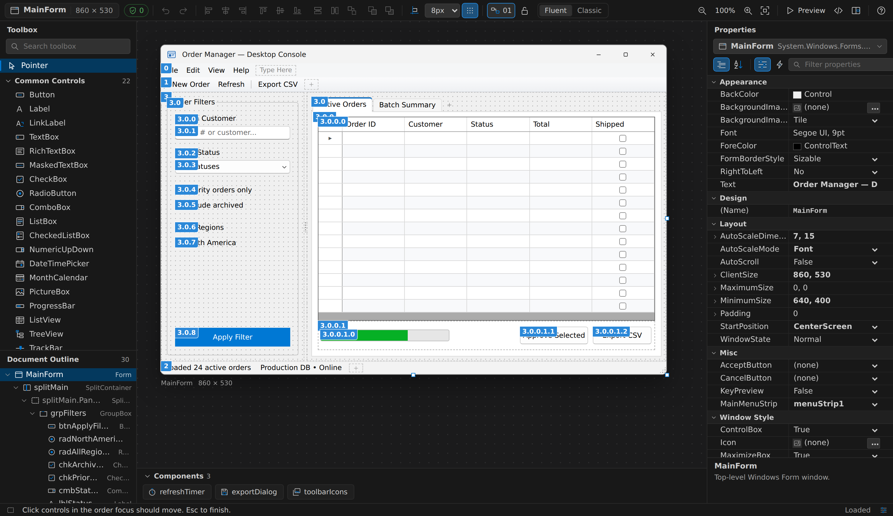
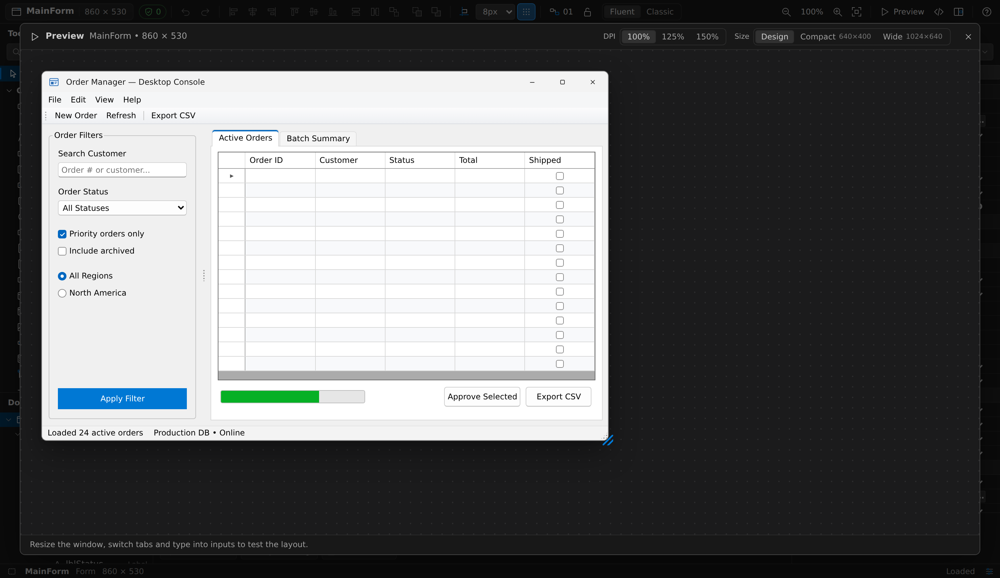

# Modern WinForms Designer

A visual Windows Forms designer for VS Code, inspired by Visual Studio 2026.

Design, edit, and preview C# `.Designer.cs` forms directly inside a VS Code editor tab on Windows, macOS, and Linux — no external window and no `.NET` runtime required.

[](https://code.visualstudio.com/)
[](#requirements)
[](#how-code-round-tripping-works)
[](LICENSE)


## Why v1.0

Earlier releases (`v0.0.1`–`v0.0.4`) launched a separate Windows-only `.NET 6` executable (`SWD4CS.exe`). Starting with `v1.0.0`, the designer is built directly into VS Code as a native Custom Editor (`winformsDesigner.editor`) backed by a TypeScript C# `.Designer.cs` parser, surgical code generator, and React design canvas.

Your visual edits flow straight through VS Code's native document buffer: `Ctrl+S` saves normally, `Ctrl+Z` / `Ctrl+Y` integrate with undo history, side-by-side `.Designer.cs` text edits stay in sync, and you can inspect or build forms on any OS.

## Installation

### VS Code Marketplace

Search for **Modern WinForms Designer** in the Extensions view (`Ctrl+Shift+X`), or run Quick Open (`Ctrl+P`):

```text
ext install ToTt0G.winforms-designer-modern
```

### Open VSX (Cursor, Windsurf, VSCodium)

Search for **Modern WinForms Designer** (`ToTt0G.winforms-designer-modern`) in your editor's Extensions view.

### Install from VSIX

Download `winforms-designer-modern-1.0.0.vsix` from [GitHub Releases](https://github.com/ToTt0G/winforms-designer-vscode/releases) and install it via the CLI:

```bash
code --install-extension winforms-designer-modern-1.0.0.vsix
```

Or open Extensions (`Ctrl+Shift+X`), open the **`...`** menu, and choose **Install from VSIX...**.

## Quick Start

1. Open any `Form.cs` or `Form.Designer.cs` file (you can try [`samples/OrderManagerDemo/MainForm.Designer.cs`](samples/OrderManagerDemo/MainForm.Designer.cs) in this repository).
2. Press **`Shift+F7`**, click the **Open WinForms Designer** icon in the editor title bar, or right-click the file in the Explorer and choose **Open WinForms Designer**.
3. Drag controls from the **Toolbox**, edit properties or wire events in the **Properties** sidebar, and save with **`Ctrl+S`**.
4. Press **`F7`** to jump to the code-behind file, or click the split button in the toolbar to view `.Designer.cs` side by side.

To create a form from scratch, right-click a folder in the Explorer and select **New Windows Form...** (choose from Blank Form, OK/Cancel Dialog, Master-Detail Workspace, Settings Window, Sign-In Form, or Dashboard) or **New User Control...**.

## Features

### Visual Studio-Style Design Surface

- **Snaplines and grid layout**: Blue alignment/margin/padding snaplines, magenta text-baseline snaplines, configurable grid (`4` / `8` / `12` / `16` px), and `Alt`-drag free placement.
- **Full container layout solver**: Live rendering and drag-reparenting for `Panel`, `GroupBox`, `TabControl` / `TabPage`, `SplitContainer` (draggable splitter bar + `Panel1` / `Panel2`), `FlowLayoutPanel` (all four flow directions), `TableLayoutPanel` (cell grid, spans, `ColumnStyles` / `RowStyles`), and docked strips (`MenuStrip`, `ToolStrip`, `StatusStrip`).
- **Anchor and dock behavior**: Resizing a form or container automatically repositions and resizes anchored children (`Top`, `Bottom`, `Left`, `Right`) and recalculates docked layouts.
- **Multi-select alignment tools**: Rubber-band marquee selection, `Ctrl`/`Shift`-click multi-select, align edges/centers, make same width/height/size, equalize horizontal/vertical spacing, center in container, lock controls, and Z-order (`Bring to Front` / `Send to Back`).
- **Smart tags and inline editing**: Context action popups on controls (dock/undock, edit columns/items/tabs, multiline toggle, insert standard strip items) and `F2` inline text editing.
- **Component tray and Document Outline**: Non-visual components (`Timer`, `ImageList`, `OpenFileDialog`, `SaveFileDialog`, `ToolTip`, `ErrorProvider`, `ContextMenuStrip`, etc.) live in the bottom tray; the Document Outline shows the full parent/child tree with drag reordering and visibility indicators.

### Property Grid, Collection Editors, and Events Inspector


- **Rich property editors**: Categorized and alphabetical views, search filter, multi-object editing, bold modified indicators, right-click Reset, visual 4-arm **Anchor** picker, 5-zone **Dock** picker, 3×3 **ContentAlignment** picker, 3-tab **Color** picker (Custom / Web / System), **Font** picker, **Control Reference** pickers (`AcceptButton`, `CancelButton`, `MainMenuStrip`, `ContextMenuStrip`, `ImageList`), and `.resx`-backed **Image / Icon** picker.
- **Dedicated collection editors**: String items (`ComboBox`, `ListBox`, `CheckedListBox`), `DataGridView` columns, `ListView` columns, hierarchical `TreeView` nodes, `TabPage` collections, `MenuStrip` / `ToolStrip` / `StatusStrip` items (with "Insert Standard Items"), and `TableLayoutPanel` rows/columns.
- **Code-behind event wiring**: Double-click a control (or pick/create a handler in the Events tab) to wire `+=` in `.Designer.cs`, generate the typed handler stub in `.cs` matching your file's namespace and nullable style, and place the cursor inside the handler body.

### Visual Tab Order Mode



Toggle **Tab Order** in the toolbar to overlay hierarchical `TabIndex` badges across containers and click controls in the exact focus order you want. Press `Esc` when finished.

### Live Interactive Preview and Layout Auditor



- **Interactive Preview**: Test typing into inputs, switching tabs, dragging splitters, and resizing the form under **100% / 125% / 150% DPI** and **Design / Compact / Wide** presets without compiling.
- **Fluent and Classic rendering**: Switch between Windows 11 Fluent-styled controls and Classic WinForms chrome, while the designer shell automatically follows your VS Code Dark, Light, or High Contrast theme.
- **Live Layout & Accessibility Audit**: Continuously checks for overlapping controls, out-of-bounds placement, duplicate `TabIndex` values, missing `AcceptButton`/`CancelButton` on `FixedDialog` forms, missing accessible labels, and out-of-range `NumericUpDown` / `ProgressBar` / `SplitContainer` values. Clicking an issue jumps straight to the control.

## Supported Controls

59 built-in WinForms types across all standard Toolbox categories, plus preservation of custom and third-party controls as visual placeholders:

| Category | Controls |
| --- | --- |
| **Common Controls** | `Button`, `CheckBox`, `CheckedListBox`, `ComboBox`, `DateTimePicker`, `DomainUpDown`, `HScrollBar`, `Label`, `LinkLabel`, `ListBox`, `ListView`, `MaskedTextBox`, `MonthCalendar`, `NotifyIcon`, `NumericUpDown`, `PictureBox`, `ProgressBar`, `PropertyGrid`, `RadioButton`, `RichTextBox`, `TextBox`, `ToolTip`, `TrackBar`, `TreeView`, `VScrollBar`, `WebBrowser` |
| **Containers** | `FlowLayoutPanel`, `GroupBox`, `Panel`, `SplitContainer`, `Splitter`, `TabControl`, `TabPage`, `TableLayoutPanel` |
| **Menus & Toolbars** | `ContextMenuStrip`, `MenuStrip`, `StatusStrip`, `ToolStrip` |
| **Data** | `BindingNavigator`, `BindingSource`, `DataGridView` |
| **Components** | `BackgroundWorker`, `ErrorProvider`, `FileSystemWatcher`, `HelpProvider`, `ImageList`, `Timer` |
| **Dialogs & Printing** | `ColorDialog`, `FolderBrowserDialog`, `FontDialog`, `OpenFileDialog`, `PageSetupDialog`, `PrintDialog`, `PrintDocument`, `PrintPreviewControl`, `PrintPreviewDialog`, `SaveFileDialog` |
| **Root Types** | `Form`, `UserControl` |

## Keyboard Shortcuts

Press **`?`** while the design canvas is focused to view the built-in shortcut reference at any time.

| Action | Shortcut |
| --- | --- |
| Open designer from `.cs` / `.Designer.cs` | `Shift+F7` |
| Jump to code-behind from designer | `F7` |
| Focus Properties / Toolbox search | `F4` / `Ctrl+Shift+T` (`Ctrl+F6`) |
| Nudge by grid size / 1 px | `Arrow` / `Ctrl+Arrow` |
| Resize by grid size / 1 px | `Shift+Arrow` / `Ctrl+Shift+Arrow` |
| Ignore snaplines & grid while dragging | `Alt+Drag` |
| Edit control text in place | `F2` |
| Go to default event handler | `Enter` or double-click |
| Duplicate / Copy / Cut / Paste / Delete | `Ctrl+D` / `Ctrl+C` / `Ctrl+X` / `Ctrl+V` / `Del` |
| Undo / Redo | `Ctrl+Z` / `Ctrl+Y` (`Ctrl+Shift+Z`) |
| Zoom in / out / reset | `Ctrl++` / `Ctrl+-` / `Ctrl+0` |
| Select next / previous / parent control | `Tab` / `Shift+Tab` / `Esc` |

## Settings

| Setting | Default | Description |
| --- | --- | --- |
| `winformsDesigner.gridSize` | `8` | Snap grid spacing in pixels (`4`, `8`, `12`, `16`). |
| `winformsDesigner.layoutMode` | `"snaplines"` | Default alignment mode (`"snaplines"` or `"grid"`). |
| `winformsDesigner.showGrid` | `true` | Show the alignment dot grid on the design surface. |
| `winformsDesigner.renderStyle` | `"fluent"` | Control preview style (`"fluent"` or `"classic"`). |
| `winformsDesigner.codeStyle.useThisQualifier` | `"auto"` | Prefix control references with `this.` (`"auto"`, `"always"`, `"never"`). |
| `winformsDesigner.codeStyle.eventHandlerStyle` | `"auto"` | Event wiring syntax (`"auto"`, `"shorthand"`, `"explicitDelegate"`). |

## How Code Round-Tripping Works

The C# engine parses `InitializeComponent()` and field declarations into an AST and performs **surgical edits** back to the `.Designer.cs` document:

- Works with both **`.NET Framework 4.x`** (block-scoped namespaces, `this.`, explicit `new System.EventHandler(...)`) and **`.NET 6`–`.NET 10`** (file-scoped namespaces, nullable annotations, target-typed `new()`, shorthand event wiring).
- Preserves custom comments, helper methods, `Dispose(bool)`, custom modifiers, local `DataGridViewCellStyle` variables, `ComponentResourceManager` / `ApplyResources` calls, unknown custom control types, and unrecognized property expressions.
- Automatically resolves sibling `.resx` and `Properties/Resources.resx` images for preview, and updates `.resx` entries when picking images.
- Switches safely to **read-only mode** with a clear banner if a file has conditional compilation (`#if` / `#endif`) inside `InitializeComponent()` or lacks a standard `InitializeComponent()` block, so hand-written code is never overwritten.

## Requirements

- **VS Code** `1.85.0` or newer
- **OS**: Windows, macOS, or Linux (no `.NET` runtime is needed to design forms; compiling and running WinForms apps still targets Windows via the .NET SDK)

## Development

```bash
git clone https://github.com/ToTt0G/winforms-designer-vscode.git
cd winforms-designer-vscode/winforms-designer-extension

npm ci
npm run build      # Production bundle (dist/extension.js, dist/webview.js, dist/webview.css)
npm test           # Typecheck + production build + 90 unit & extension-host tests
npm run test:e2e   # 10 headless Chromium end-to-end tests
npm run package    # Build .vsix package
```

Press **F5** in VS Code with `winforms-designer-extension` open to launch an Extension Development Host.

### Repository Layout

```text
winforms-designer-vscode/
├── samples/OrderManagerDemo/      # Realistic multi-control sample WinForms project
├── TestDesignFile/                # Minimal .Designer.cs sample
└── winforms-designer-extension/
    ├── src/
    │   ├── shared/                # AST model, 59-control catalog, protocol, layout auditor
    │   ├── core/                  # C# lexer, parser, surgical generator, code-behind, .resx, templates
    │   ├── extension/             # CustomEditorProvider, commands, form resolver, settings
    │   └── webview/               # React design surface, layout/snapline engine, inspectors, editors
    ├── test/                      # Unit, extension-host, and Playwright Chromium E2E suites
    ├── images/                    # Extension icon and screenshots
    └── esbuild.mjs                # Extension & webview bundler
```

## Credits

Versions `0.0.1` through `0.0.4` of this extension wrapped [SWD4CS](https://github.com/hry2566/SWD4CS) by **hry2566**. Starting with `1.0.0`, the designer is implemented natively inside VS Code.

## License

MIT — see [LICENSE](LICENSE).
