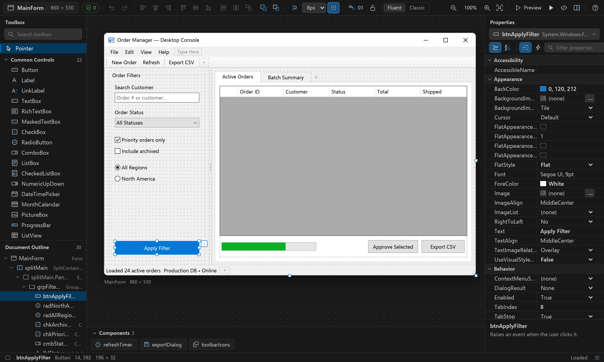
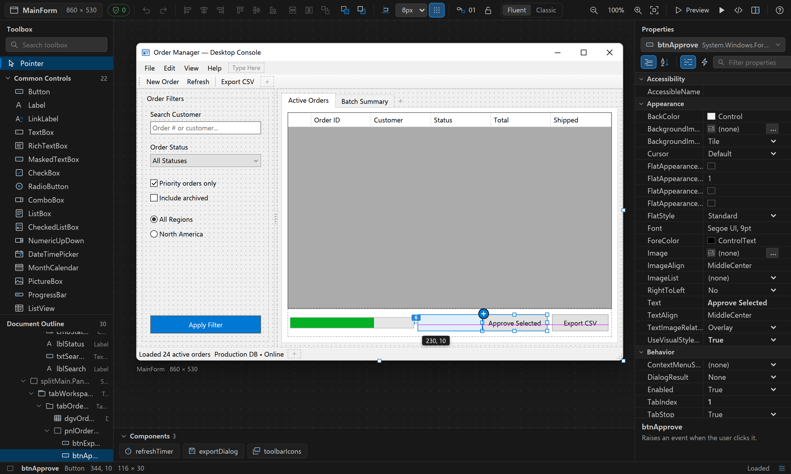
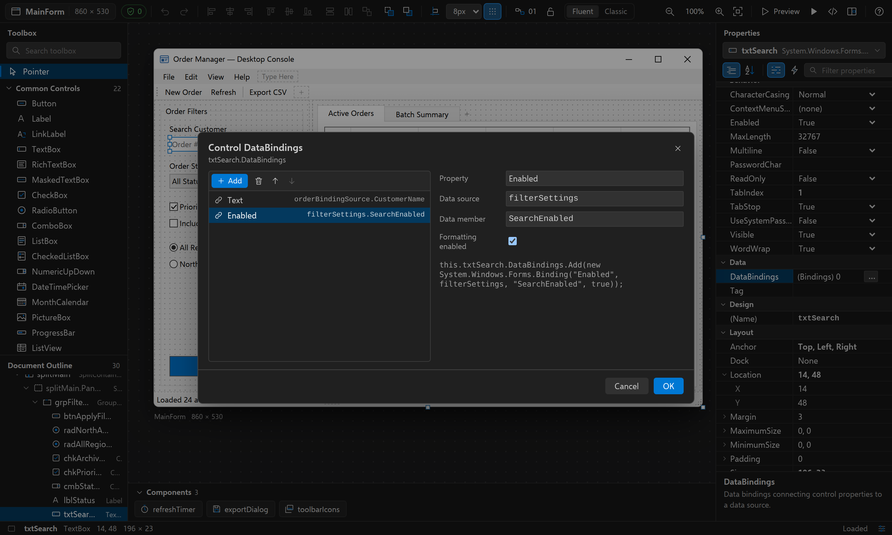
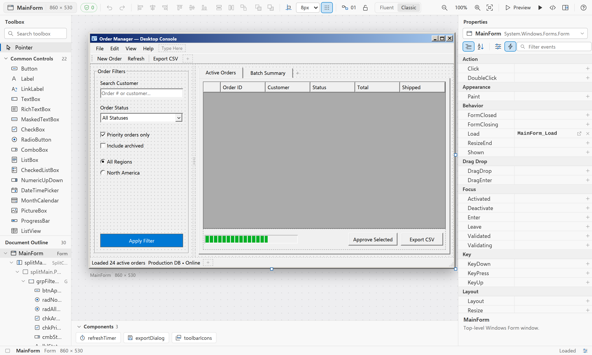
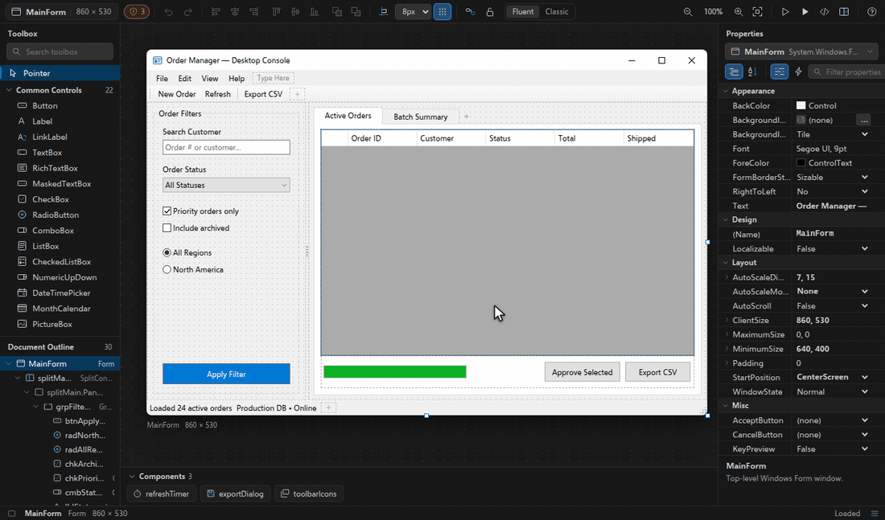

# Modern WinForms Designer

A visual Windows Forms designer that runs inside VS Code, on any OS.

Open a `.Designer.cs` file and you get a Visual Studio-style design surface in an editor tab: Toolbox, Document Outline, Property Grid, Component Tray, snaplines, collection editors and an interactive preview. Every edit is written back to your C# with surgical precision. No external window, no `bin/` to compile first, and no .NET runtime needed to design.

[](https://code.visualstudio.com/)
[](#requirements)
[](#c-round-tripping)
[](LICENSE)


<sub>Type a menu item straight onto the MenuStrip, Ctrl+drag a copy of a button into another container with snaplines, and drag a SplitContainer splitter while anchored children reflow.</sub>

## What sets it apart

Most WinForms designers outside Visual Studio are separate Windows executables that load your compiled assembly. This one is a native VS Code custom editor that reads and writes C# directly.

| | Modern WinForms Designer | External Windows `.exe` designers |
| --- | --- | --- |
| **Where it runs** | Inside VS Code on Windows, macOS, Linux, WSL and ARM64 | A separate window, Windows only |
| **Setup** | Small VSIX. No .NET runtime needed to design | Requires a matching .NET Desktop Runtime |
| **Opening a form** | Works immediately from source; no `bin/` build first | Usually needs a compiled project or assembly |
| **Rendering** | Pixel-faithful Fluent (Windows 11) and Classic (Win32) styles that match compiled WinForms in design mode and in Live Preview | Host-OS rendering, design mode only |
| **Preview** | Interactive: MenuStrip dropdowns, NumericUpDown spinners, TrackBar, DataGridView sorting, 100% / 125% / 150% DPI, Compact / Wide reflow | Run the app to find out |
| **Run and build** | One-click Run / Build / Stop from the toolbar and status bar | Switch back to a terminal or IDE |
| **Layout checks** | Live layout, High-DPI and accessibility auditor with one-click **Fix** and **Fix All** | None |
| **Saving** | VS Code's own buffer: `Ctrl+S`, undo/redo, side-by-side text edits stay in sync | Separate save flow, external edits not synchronized |
| **Code safety** | Surgical edits that keep comments, helper methods, custom controls, `ComponentResourceManager` and `DataGridViewCellStyle` | Often regenerates the whole file |

## Installation

**VS Code Marketplace.** Search for **Modern WinForms Designer** in the Extensions view (`Ctrl+Shift+X`), or run Quick Open (`Ctrl+P`):

```text
ext install ToTt0G.winforms-designer-modern
```

**Open VSX** (Cursor, Windsurf, VSCodium). Search for `ToTt0G.winforms-designer-modern` in your editor's Extensions view.

**From VSIX.** Download the latest `.vsix` from [GitHub Releases](https://github.com/ToTt0G/winforms-designer-vscode/releases), then:

```bash
code --install-extension winforms-designer-modern-*.vsix
```

## Quick start

1. Open any `Form.cs` or `Form.Designer.cs`. [`samples/OrderManagerDemo/MainForm.Designer.cs`](samples/OrderManagerDemo/MainForm.Designer.cs) is a good first file.
2. Press **`Shift+F7`**, click **Open WinForms Designer** in the editor title bar, or right-click the file in the Explorer.
3. Drag controls from the **Toolbox**, set properties or wire events in the **Properties** pane, and save with **`Ctrl+S`**.
4. Press **`F7`** to jump to the code-behind, or click **Run** in the toolbar to build and launch the app.

No project yet? Run **New WinForms Project...** from the Command Palette or the WinForms Explorer and pick `net10.0-windows`, `net9.0-windows`, `net8.0-windows` or `net48`.

## Features

### A design surface that behaves like Visual Studio



- **Snaplines and grid.** Blue edge, margin and padding snaplines, magenta text-baseline snaplines, a 4 / 8 / 12 / 16 px grid, and `Alt`-drag to place freely.
- **Real container layout.** `Panel`, `GroupBox`, `TabControl`, `SplitContainer` with a draggable splitter, `FlowLayoutPanel` in all four directions, `TableLayoutPanel` with spans and row/column styles, and docked strips. Drag controls between containers to reparent them.
- **Anchor and Dock.** Resize the form or a container and anchored children move and stretch exactly as they will at runtime.
- **On-canvas strip editing.** Click **Type Here** on a `MenuStrip`, `ToolStrip` or `StatusStrip` to add items, double-click to rename, and hover to delete.
- **Ctrl+Drag to duplicate.** Hold `Ctrl` while dragging to drop a copy with fresh names; the original stays put.
- **Selection tools.** Marquee and `Ctrl`/`Shift` multi-select, align edges and centers, match sizes, equalize spacing, center in container, lock, and Z-order.
- **Smart tags, `F2` inline text editing, a Component Tray** for non-visual components, and a **Document Outline** with drag reordering.



### Property Grid and editors



- Categorized and alphabetical views, search, multi-object editing, bold modified values, and right-click **Reset**.
- Visual pickers for **Anchor**, **Dock**, **ContentAlignment**, **Color** (Custom / Web / System), **Font**, control references (`AcceptButton`, `CancelButton`, `MainMenuStrip`, `ContextMenuStrip`, `ImageList`) and `.resx`-backed **Image / Icon**.
- Collection editors for string items, `DataGridView` and `ListView` columns, `TreeView` nodes, `TabPage`s, strip items (with **Insert Standard Items**), `TableLayoutPanel` rows and columns, and **DataBindings**, with a live preview of the `DataBindings.Add(...)` statement it will write.

### Events and themes



- The **Events** tab lists handlers already present in your code-behind. Double-click a control, or pick or create a handler, to wire `+=` in `.Designer.cs` and generate a typed stub in `.cs` that matches your namespace and nullable style.
- Switch between **Fluent** (Windows 11) and **Classic** (Win32: gradient title bar, 3D bevels, segmented progress bar) rendering. The designer shell follows your VS Code Dark, Light or High Contrast theme.

### Live Preview and the layout auditor



- **Live Layout, High-DPI and Accessibility Auditor.** Continuously checks for overlapping or out-of-bounds controls, duplicate `TabIndex`, `AutoScaleMode.None`, missing `AcceptButton` / `CancelButton` on dialogs, controls without accessible text, and out-of-range `NumericUpDown`, `ProgressBar` and `SplitContainer` values. Click an issue to select the control. **Fix** applies one correction; **Fix All** applies every automatic fix as a single undo step.
- **Interactive Live Preview.** Open real MenuStrip dropdowns, spin NumericUpDowns, drag TrackBars and splitters, sort DataGridView columns, type into inputs and switch tabs. Flip between **100% / 125% / 150% DPI** and **Design / Compact / Wide** sizes to watch Anchor and Dock reflow. Design-time artifacts such as placeholder grid rows and **Type Here** slots never appear.


### Visual Tab Order


Toggle **Tab Order** in the toolbar to show hierarchical `TabIndex` badges across containers, then click controls in the order focus should move. Press `Esc` when you're done.

### Run, Build and Stop

The toolbar **Run** button and a status bar item (**Run**, **Building...**, **Stop**) drive the active project. Before each run the designer saves all files and stops the previous instance, so the build never fails on a locked `.exe` (MSB3027).

| Host | What Run does |
| --- | --- |
| Windows, .NET 6–10 | `dotnet build` / `dotnet run` |
| Windows, .NET Framework 4.x | Locates MSBuild through `vswhere`, builds, then launches the `.exe` |
| WSL | Calls Windows `dotnet.exe` with paths converted by `wslpath`, so the window opens on your Windows desktop |
| macOS and Linux | Compile-check with `EnableWindowsTargeting=true`, with Live Preview for the UI |

### Project tooling

- **WinForms Explorer** in the Activity Bar lists every form and user control in the workspace.
- **New WinForms Project...** scaffolds a runnable project for `net10.0-windows`, `net9.0-windows`, `net8.0-windows` or `net48`.
- **New Windows Form...** offers six starter templates: Blank, OK/Cancel Dialog, Master-Detail Workspace, Settings Window, Sign-In Form and Dashboard. **New User Control...** is there too.
- **Delete Form & Sibling Files** removes `.cs`, `.Designer.cs` and `.resx` together.
- **Explorer file nesting** groups `Form.Designer.cs` and `Form.resx` under `Form.cs` by default.
- **Inherited forms.** Base `Form` and `UserControl` chains are resolved statically from source. Inherited controls render with a badge, stay read-only, and are never written into the derived file.
- **Localization.** Switch between culture-specific `.resx` files (`MainForm.de.resx` and so on) from the toolbar and edit localized text in place.

## Supported controls

59 built-in WinForms types. Custom and third-party controls are preserved and drawn as placeholders.

| Category | Controls |
| --- | --- |
| **Common Controls** | `Button`, `CheckBox`, `CheckedListBox`, `ComboBox`, `DateTimePicker`, `DomainUpDown`, `HScrollBar`, `Label`, `LinkLabel`, `ListBox`, `ListView`, `MaskedTextBox`, `MonthCalendar`, `NotifyIcon`, `NumericUpDown`, `PictureBox`, `ProgressBar`, `PropertyGrid`, `RadioButton`, `RichTextBox`, `TextBox`, `ToolTip`, `TrackBar`, `TreeView`, `VScrollBar`, `WebBrowser` |
| **Containers** | `FlowLayoutPanel`, `GroupBox`, `Panel`, `SplitContainer`, `Splitter`, `TabControl`, `TabPage`, `TableLayoutPanel` |
| **Menus & Toolbars** | `ContextMenuStrip`, `MenuStrip`, `StatusStrip`, `ToolStrip` |
| **Data** | `BindingNavigator`, `BindingSource`, `DataGridView` |
| **Components** | `BackgroundWorker`, `ErrorProvider`, `FileSystemWatcher`, `HelpProvider`, `ImageList`, `Timer` |
| **Dialogs & Printing** | `ColorDialog`, `FolderBrowserDialog`, `FontDialog`, `OpenFileDialog`, `PageSetupDialog`, `PrintDialog`, `PrintDocument`, `PrintPreviewControl`, `PrintPreviewDialog`, `SaveFileDialog` |
| **Root Types** | `Form`, `UserControl` |

## Keyboard shortcuts

Press **`?`** on the canvas for the full reference.

| Action | Shortcut |
| --- | --- |
| Open designer from `.cs` / `.Designer.cs` | `Shift+F7` |
| Jump to code-behind | `F7` |
| Focus Properties / Toolbox search | `F4` / `Ctrl+Shift+T` (`Ctrl+F6`) |
| Nudge by grid / 1 px | `Arrow` / `Ctrl+Arrow` |
| Resize by grid / 1 px | `Shift+Arrow` / `Ctrl+Shift+Arrow` |
| Drag without snapping | `Alt+Drag` |
| Drag a copy | `Ctrl+Drag` |
| Edit text in place | `F2` |
| Go to default event handler | `Enter` or double-click |
| Duplicate / Copy / Cut / Paste / Delete | `Ctrl+D` / `Ctrl+C` / `Ctrl+X` / `Ctrl+V` / `Del` |
| Undo / Redo | `Ctrl+Z` / `Ctrl+Y` (`Ctrl+Shift+Z`) |
| Zoom in / out / reset | `Ctrl++` / `Ctrl+-` / `Ctrl+0` |
| Select next / previous / parent | `Tab` / `Shift+Tab` / `Esc` |

## Settings

| Setting | Default | Description |
| --- | --- | --- |
| `winformsDesigner.gridSize` | `8` | Snap grid spacing in pixels (`4`, `8`, `12`, `16`). |
| `winformsDesigner.layoutMode` | `"snaplines"` | Default alignment mode (`"snaplines"` or `"grid"`). |
| `winformsDesigner.showGrid` | `true` | Show the dot grid on the design surface. |
| `winformsDesigner.renderStyle` | `"fluent"` | Control rendering (`"fluent"` or `"classic"`). |
| `winformsDesigner.codeStyle.useThisQualifier` | `"auto"` | Prefix control references with `this.` (`"auto"`, `"always"`, `"never"`). |
| `winformsDesigner.codeStyle.eventHandlerStyle` | `"auto"` | Event wiring syntax (`"auto"`, `"shorthand"`, `"explicitDelegate"`). |

## C# round-tripping

The engine parses `InitializeComponent()` and the field declarations into a syntax tree, then applies targeted edits back to `.Designer.cs`:

- Handles **.NET Framework 4.x** style (block-scoped namespaces, `this.`, `new System.EventHandler(...)`) and **.NET 6–10** style (file-scoped namespaces, nullable annotations, target-typed `new()`, shorthand event wiring), and matches whichever the file already uses.
- Keeps comments, helper methods, `Dispose(bool)`, custom modifiers, local `DataGridViewCellStyle` variables, `ComponentResourceManager` / `ApplyResources` calls, unknown control types and property expressions it doesn't recognize.
- Reads sibling `.resx` and `Properties/Resources.resx` images for display and updates `.resx` entries when you pick an image.
- Opens in **read-only mode** with a banner when `InitializeComponent()` contains `#if` blocks or isn't in the standard shape, so hand-written code is never overwritten.

## Requirements

- **VS Code** 1.85 or newer.
- **OS**: Windows, macOS, Linux or WSL, on x64 or ARM64. Designing needs no .NET runtime. Running a WinForms app still needs Windows and the .NET SDK (or MSBuild for .NET Framework).

## Development

```bash
git clone https://github.com/ToTt0G/winforms-designer-vscode.git
cd winforms-designer-vscode/winforms-designer-extension

npm ci
npm run build      # dist/extension.js, dist/webview.js, dist/webview.css
npm test           # Typecheck, production build, 125 unit & extension-host tests
npm run test:e2e   # 16 headless Chromium end-to-end tests
npm run package    # Build the .vsix
```

Press **F5** with `winforms-designer-extension` open to launch an Extension Development Host.

```text
winforms-designer-vscode/
├── samples/OrderManagerDemo/      # Multi-control sample WinForms project
├── TestDesignFile/                # Minimal .Designer.cs sample
└── winforms-designer-extension/
    ├── src/
    │   ├── shared/                # Document model, 59-control catalog, protocol, auditor
    │   ├── core/                  # C# lexer, parser, generator, code-behind, .resx, scaffolding
    │   ├── extension/             # Custom editor, commands, project runner, WinForms Explorer
    │   └── webview/               # React design surface, layout and snapline engine, editors
    ├── test/                      # Unit, extension-host and Playwright Chromium E2E suites
    ├── images/                    # Icons, screenshots and demo GIFs
    └── esbuild.mjs                # Extension and webview bundler
```

## Credits

Versions 0.0.1 through 0.0.4 wrapped [SWD4CS](https://github.com/hry2566/SWD4CS) by **hry2566**. From 1.0.0 the designer is implemented natively inside VS Code.

## License

MIT. See [LICENSE](LICENSE).
