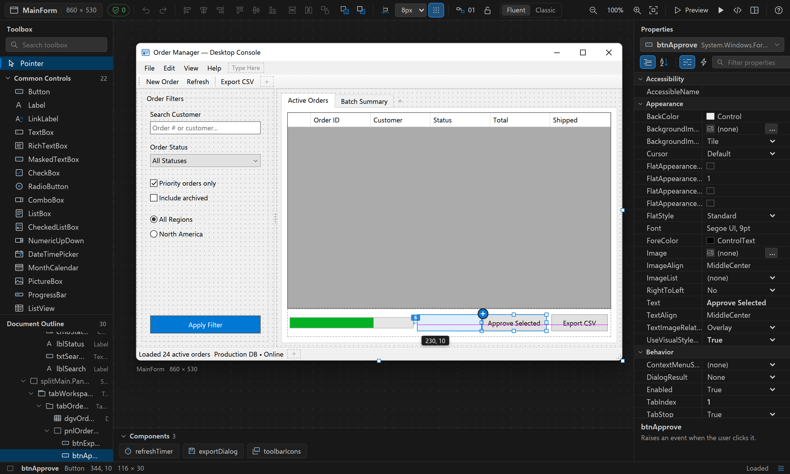
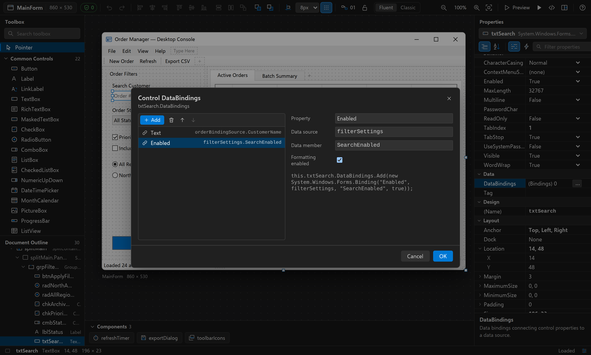
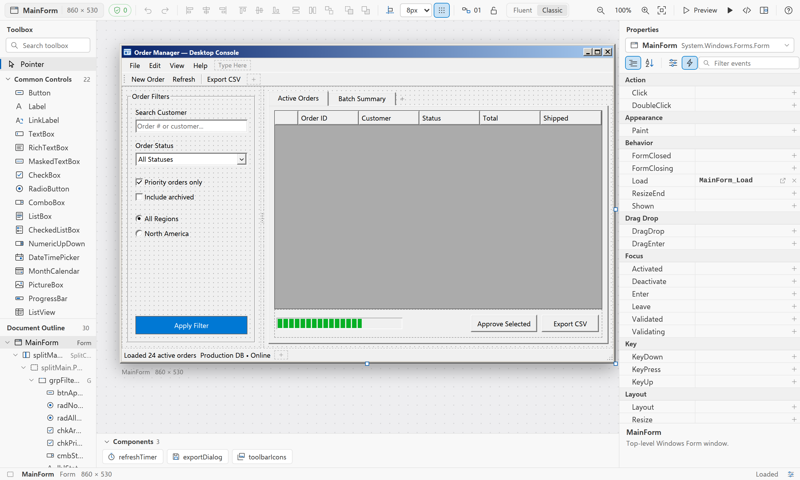
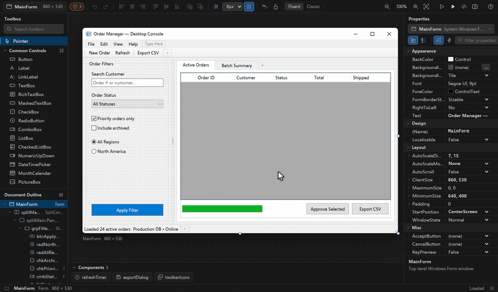
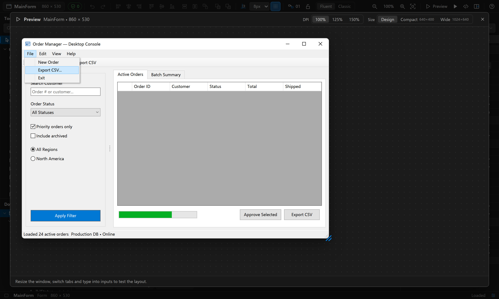
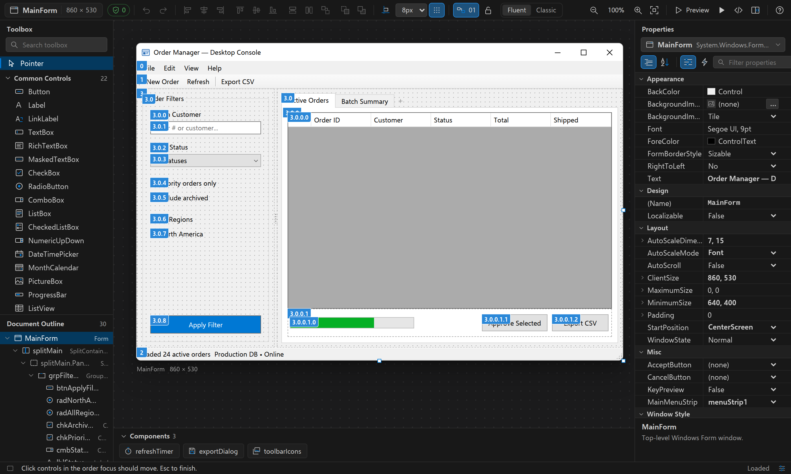

# Modern WinForms Designer

A visual Windows Forms designer that runs inside VS Code, on any OS.

Open a `.Designer.cs` file and you get a Visual Studio-style design surface in an editor tab: Toolbox, Document Outline, Property Grid, Component Tray, snaplines, collection editors and an interactive preview. Every edit is written back to your C# with surgical precision. No external window, no `bin/` to compile first, and no .NET runtime needed to design.

## What sets it apart

| | Modern WinForms Designer | External Windows `.exe` designers |
| --- | --- | --- |
| **Where it runs** | Inside VS Code on Windows, macOS, Linux, WSL and ARM64 | A separate window, Windows only |
| **Setup** | Small VSIX. No .NET runtime needed to design | Requires a matching .NET Desktop Runtime |
| **Opening a form** | Works immediately from source; no `bin/` build first | Usually needs a compiled project or assembly |
| **Rendering** | Pixel-faithful Fluent (Windows 11) and Classic (Win32) styles that match compiled WinForms in design mode and in Live Preview | Host-OS rendering, design mode only |
| **Preview** | Interactive: MenuStrip dropdowns, NumericUpDown spinners, TrackBar, DataGridView sorting, 100% / 125% / 150% DPI, Compact / Wide reflow | Run the app to find out |
| **Run and build** | One-click Run / Build / Stop from the toolbar and status bar | Switch back to a terminal or IDE |
| **Layout checks** | Live layout, High-DPI and accessibility auditor with one-click **Fix** and **Fix All** | None |
| **Saving** | VS Code's own buffer: `Ctrl+S`, undo/redo, side-by-side text edits stay in sync | Separate save flow, external edits not synchronized |
| **Code safety** | Surgical edits that keep comments, helper methods, custom controls, `ComponentResourceManager` and `DataGridViewCellStyle` | Often regenerates the whole file |

## Quick start

1. Open any `Form.cs` or `Form.Designer.cs`.
2. Press **`Shift+F7`**, click **Open WinForms Designer** in the editor title bar, or right-click the file in the Explorer.
3. Drag controls from the **Toolbox**, set properties or wire events in the **Properties** pane, and save with **`Ctrl+S`**.
4. Press **`F7`** to jump to the code-behind, or click **Run** in the toolbar to build and launch the app.

No project yet? Run **New WinForms Project...** from the Command Palette or the WinForms Explorer and pick `net10.0-windows`, `net9.0-windows`, `net8.0-windows` or `net48`.

## A design surface that behaves like Visual Studio

- **Snaplines and grid.** Blue edge, margin and padding snaplines, magenta text-baseline snaplines, a 4 / 8 / 12 / 16 px grid, and `Alt`-drag to place freely.
- **Real container layout.** `Panel`, `GroupBox`, `TabControl`, `SplitContainer` with a draggable splitter, `FlowLayoutPanel`, `TableLayoutPanel` and docked strips. Drag controls between containers to reparent them.
- **Anchor and Dock.** Resize the form or a container and anchored children move and stretch exactly as they will at runtime.
- **On-canvas strip editing.** Click **Type Here** on a `MenuStrip`, `ToolStrip` or `StatusStrip` to add items, double-click to rename, and hover to delete.
- **Ctrl+Drag to duplicate.** Hold `Ctrl` while dragging to drop a copy with fresh names; the original stays put.
- **Selection tools.** Marquee and multi-select, align, match sizes, equalize spacing, center, lock and Z-order, plus smart tags, `F2` inline text editing, a Component Tray and a Document Outline.

## Property Grid and editors

- Categorized and alphabetical views, search, multi-object editing, bold modified values and right-click **Reset**.
- Visual pickers for **Anchor**, **Dock**, **ContentAlignment**, **Color**, **Font**, control references and `.resx`-backed **Image / Icon**.
- Collection editors for items, `DataGridView` and `ListView` columns, `TreeView` nodes, `TabPage`s, strip items, `TableLayoutPanel` rows and columns, and **DataBindings**.

## Events and themes

- The **Events** tab lists handlers already in your code-behind. Double-click a control to wire `+=` in `.Designer.cs` and generate a typed stub in `.cs`.
- Switch between **Fluent** (Windows 11) and **Classic** (Win32) rendering. The designer follows your VS Code Dark, Light or High Contrast theme.

## Live Preview and the layout auditor

- **Live Layout, High-DPI and Accessibility Auditor.** Flags overlapping or out-of-bounds controls, duplicate `TabIndex`, `AutoScaleMode.None`, missing dialog `AcceptButton` / `CancelButton`, missing accessible text, and invalid `NumericUpDown`, `ProgressBar` and `SplitContainer` values. **Fix** corrects one issue; **Fix All** corrects every fixable issue in a single undo step.
- **Interactive Live Preview.** Open MenuStrip dropdowns, spin NumericUpDowns, drag TrackBars, sort DataGridView columns and type into inputs. Switch between **100% / 125% / 150% DPI** and **Design / Compact / Wide** sizes to watch Anchor and Dock reflow. No design-time artifacts are shown.

## Visual Tab Order

Toggle **Tab Order** in the toolbar, then click controls in the order focus should move. Press `Esc` when you're done.

## Run, Build and Stop

The toolbar **Run** button and a status bar item (**Run**, **Building...**, **Stop**) drive the active project. The designer saves all files and stops the previous instance first, so builds never hit a locked `.exe` (MSB3027).

- **Windows, .NET 6–10**: `dotnet build` / `dotnet run`.
- **Windows, .NET Framework 4.x**: finds MSBuild through `vswhere`, builds, then launches the `.exe`.
- **WSL**: uses Windows `dotnet.exe` with `wslpath`-converted paths, so the window opens on your Windows desktop.
- **macOS and Linux**: compile-check with `EnableWindowsTargeting=true`, with Live Preview for the UI.

## Project tooling

- **WinForms Explorer** in the Activity Bar lists every form and user control in the workspace.
- **New WinForms Project...** for `net10.0-windows` through `net48`, **New Windows Form...** with six starter templates, and **New User Control...**.
- **Delete Form & Sibling Files** removes `.cs`, `.Designer.cs` and `.resx` together.
- **Explorer file nesting** groups `.Designer.cs` and `.resx` under their form by default.
- **Inherited forms** are resolved statically from source. Inherited controls are badged, read-only and never written into the derived file.
- **Localization**: switch between culture `.resx` files from the toolbar and edit localized text in place.

## C# round-tripping

- Handles .NET Framework 4.x and .NET 6–10 styles, and matches whichever the file already uses.
- Keeps comments, helper methods, `Dispose(bool)`, local `DataGridViewCellStyle` variables, `ComponentResourceManager` / `ApplyResources` calls, custom control types and unrecognized property expressions.
- Opens in **read-only mode** when `InitializeComponent()` contains `#if` blocks or isn't in the standard shape.

## Keyboard shortcuts

Press **`?`** on the canvas for the full reference.

| Action | Shortcut |
| --- | --- |
| Open designer from `.cs` / `.Designer.cs` | `Shift+F7` |
| Jump to code-behind | `F7` |
| Focus Properties / Toolbox search | `F4` / `Ctrl+Shift+T` (`Ctrl+F6`) |
| Nudge by grid / 1 px | `Arrow` / `Ctrl+Arrow` |
| Resize by grid / 1 px | `Shift+Arrow` / `Ctrl+Shift+Arrow` |
| Drag without snapping / drag a copy | `Alt+Drag` / `Ctrl+Drag` |
| Edit text in place | `F2` |
| Go to default event handler | `Enter` or double-click |
| Duplicate / Copy / Cut / Paste / Delete | `Ctrl+D` / `Ctrl+C` / `Ctrl+X` / `Ctrl+V` / `Del` |
| Undo / Redo | `Ctrl+Z` / `Ctrl+Y` (`Ctrl+Shift+Z`) |
| Zoom in / out / reset | `Ctrl++` / `Ctrl+-` / `Ctrl+0` |

## Settings

| Setting | Default | Description |
| --- | --- | --- |
| `winformsDesigner.gridSize` | `8` | Snap grid spacing in pixels (`4`, `8`, `12`, `16`). |
| `winformsDesigner.layoutMode` | `"snaplines"` | Default alignment mode (`"snaplines"` or `"grid"`). |
| `winformsDesigner.showGrid` | `true` | Show the dot grid on the design surface. |
| `winformsDesigner.renderStyle` | `"fluent"` | Control rendering (`"fluent"` or `"classic"`). |
| `winformsDesigner.codeStyle.useThisQualifier` | `"auto"` | Prefix control references with `this.` (`"auto"`, `"always"`, `"never"`). |
| `winformsDesigner.codeStyle.eventHandlerStyle` | `"auto"` | Event wiring syntax (`"auto"`, `"shorthand"`, `"explicitDelegate"`). |

## Requirements

- **VS Code** 1.85 or newer.
- **OS**: Windows, macOS, Linux or WSL, on x64 or ARM64. Designing needs no .NET runtime. Running a WinForms app still needs Windows and the .NET SDK (or MSBuild for .NET Framework).

## Links

- [Source and issue tracker](https://github.com/ToTt0G/winforms-designer-vscode)
- [Changelog](CHANGELOG.md)
- [License (MIT)](LICENSE)
