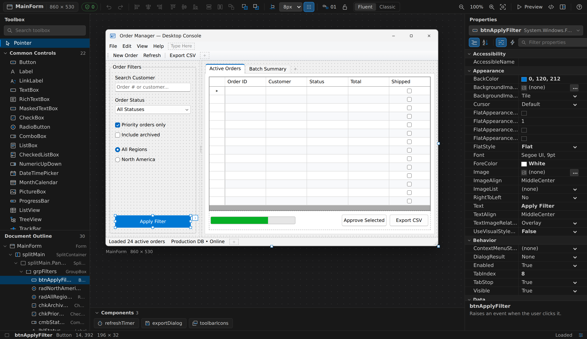

# Modern WinForms Designer

A visual Windows Forms designer for VS Code, inspired by Visual Studio 2026.

Design, edit, and preview C# `.Designer.cs` forms directly inside a VS Code editor tab on Windows, macOS, and Linux — no external window and no `.NET` runtime required.

## Quick Start

1. Open any `Form.cs` or `Form.Designer.cs` file in VS Code.
2. Press **`Shift+F7`**, click the **Open WinForms Designer** icon in the editor title bar, or right-click the file in the Explorer and select **Open WinForms Designer**.
3. Drag controls from the **Toolbox**, configure properties or wire events in the **Properties** panel, and save with **`Ctrl+S`**.
4. Press **`F7`** to jump to the code-behind file, or click the split button in the toolbar to view `.Designer.cs` side by side.

To scaffold a new form or user control, right-click a folder in the Explorer and select **New Windows Form...** (choose from Blank Form, OK/Cancel Dialog, Master-Detail Workspace, Settings Window, Sign-In Form, or Dashboard) or **New User Control...**.

## Features

### Visual Studio-Style Design Surface

- **Snaplines and grid layout**: Blue alignment/margin/padding snaplines, magenta text-baseline snaplines, configurable grid (`4` / `8` / `12` / `16` px), and `Alt`-drag free placement.
- **Full container layout solver**: Live rendering and drag-reparenting for `Panel`, `GroupBox`, `TabControl` / `TabPage`, `SplitContainer` (draggable splitter bar + `Panel1` / `Panel2`), `FlowLayoutPanel`, `TableLayoutPanel`, and docked strips (`MenuStrip`, `ToolStrip`, `StatusStrip`).
- **Anchor and dock propagation**: Resizing a form or container updates anchored children (`Top`, `Bottom`, `Left`, `Right`) and recalculates docked layouts automatically.
- **Multi-select alignment tools**: Marquee selection, align edges/centers, make same width/height/size, equalize spacing, center in container, lock controls, and Z-order controls.
- **Smart tags and inline editing**: Context action menus on controls and `F2` inline text editing.
- **Component tray and Document Outline**: Manage non-visual components (`Timer`, `ImageList`, dialogs, `ToolTip`, `ContextMenuStrip`, etc.) in the bottom tray and inspect or reorder the control hierarchy in the outline.

### Property Grid, Collection Editors, and Events Inspector

- **Rich property editors**: Categorized and alphabetical views, search filter, multi-select editing, right-click Reset, visual 4-arm **Anchor** picker, 5-zone **Dock** picker, 3×3 **ContentAlignment** picker, 3-tab **Color** picker (Custom / Web / System), **Font** picker, **Control Reference** pickers (`AcceptButton`, `CancelButton`, `MainMenuStrip`, `ContextMenuStrip`, `ImageList`), and `.resx`-backed **Image / Icon** picker.
- **Collection editors**: Dedicated dialogs for string items, `DataGridView` columns, `ListView` columns, hierarchical `TreeView` nodes, `TabPage` collections, `MenuStrip` / `ToolStrip` / `StatusStrip` items (with "Insert Standard Items"), and `TableLayoutPanel` rows/columns.
- **Code-behind event wiring**: Double-click a control or bind an event in the Events tab to wire `+=` in `.Designer.cs`, generate the typed handler in `.cs`, and jump straight into the method body.

### Visual Tab Order Mode

Toggle **Tab Order** in the toolbar to overlay hierarchical `TabIndex` badges across containers and click controls in focus order.

### Live Interactive Preview and Layout Auditor

- **Interactive Preview**: Test typing, tab switching, splitter dragging, and window resizing across **100% / 125% / 150% DPI** and **Design / Compact / Wide** presets without compiling.
- **Fluent and Classic rendering**: Toggle between Windows 11 Fluent-styled controls and Classic WinForms chrome while following your VS Code Dark, Light, or High Contrast theme.
- **Live Layout & Accessibility Audit**: Flags overlapping controls, out-of-bounds controls, duplicate `TabIndex` values, missing dialog `AcceptButton`/`CancelButton`, missing accessible text, and invalid `NumericUpDown` / `ProgressBar` / `SplitContainer` ranges.

## Supported Controls

59 built-in WinForms types across Common Controls, Containers, Menus & Toolbars, Data, Components, Dialogs & Printing, plus safe placeholder rendering for custom and third-party controls.

## Keyboard Shortcuts

Press **`?`** while the design canvas has focus to view the built-in shortcuts reference.

| Action | Shortcut |
| --- | --- |
| Open designer from `.cs` / `.Designer.cs` | `Shift+F7` |
| Jump to code-behind from designer | `F7` |
| Focus Properties / Toolbox search | `F4` / `Ctrl+Shift+T` (`Ctrl+F6`) |
| Nudge by grid size / 1 px | `Arrow` / `Ctrl+Arrow` |
| Resize by grid size / 1 px | `Shift+Arrow` / `Ctrl+Shift+Arrow` |
| Ignore snaplines & grid while dragging | `Alt+Drag` |
| Edit control text in place | `F2` |
| Go to default event handler | `Enter` or double-click |
| Duplicate / Copy / Cut / Paste / Delete | `Ctrl+D` / `Ctrl+C` / `Ctrl+X` / `Ctrl+V` / `Del` |
| Undo / Redo | `Ctrl+Z` / `Ctrl+Y` (`Ctrl+Shift+Z`) |
| Zoom in / out / reset | `Ctrl++` / `Ctrl+-` / `Ctrl+0` |

## Settings

| Setting | Default | Description |
| --- | --- | --- |
| `winformsDesigner.gridSize` | `8` | Snap grid spacing in pixels (`4`, `8`, `12`, `16`). |
| `winformsDesigner.layoutMode` | `"snaplines"` | Default alignment mode (`"snaplines"` or `"grid"`). |
| `winformsDesigner.showGrid` | `true` | Show the alignment dot grid on the design surface. |
| `winformsDesigner.renderStyle` | `"fluent"` | Control preview style (`"fluent"` or `"classic"`). |
| `winformsDesigner.codeStyle.useThisQualifier` | `"auto"` | Prefix control references with `this.` (`"auto"`, `"always"`, `"never"`). |
| `winformsDesigner.codeStyle.eventHandlerStyle` | `"auto"` | Event wiring syntax (`"auto"`, `"shorthand"`, `"explicitDelegate"`). |

## Surgical `.Designer.cs` Round-Tripping

- Supports both `.NET Framework 4.x` and `.NET 6`–`.NET 10` styles (block-scoped and file-scoped namespaces, nullable annotations, target-typed `new()`, shorthand or explicit delegate event wiring).
- Preserves custom comments, helper methods, `Dispose(bool)`, local `DataGridViewCellStyle` declarations, `ComponentResourceManager` / `ApplyResources` calls, custom control types, and unrecognized property expressions.
- Automatically opens in **read-only mode** when a file contains conditional compilation (`#if` / `#endif`) inside `InitializeComponent()` or lacks a standard `InitializeComponent()` block.

## Requirements

- **VS Code** `1.85.0` or newer
- **OS**: Windows, macOS, or Linux (no external `.NET` runtime required to edit forms)

## Links

- [Source Repository & Issue Tracker](https://github.com/ToTt0G/winforms-designer-vscode)
- [Changelog](CHANGELOG.md)
- [License (MIT)](LICENSE)
